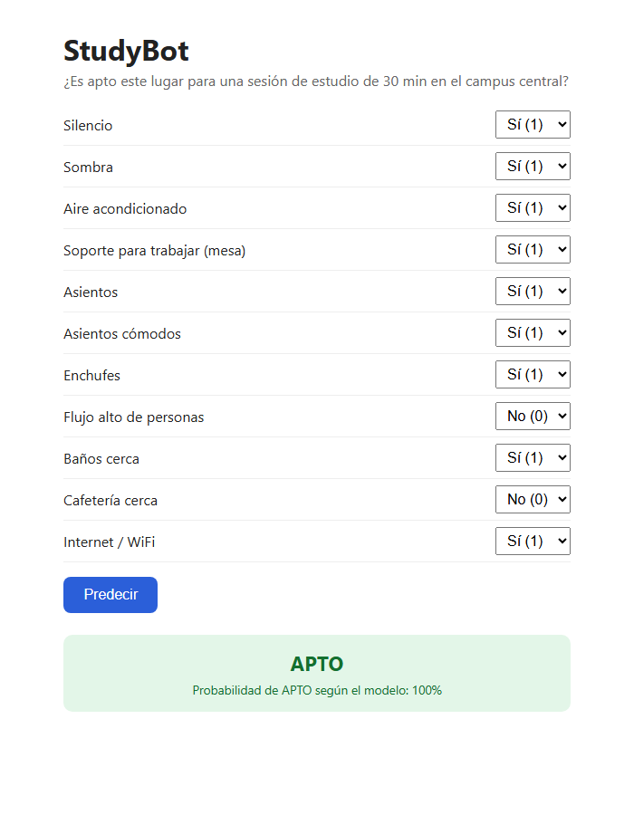
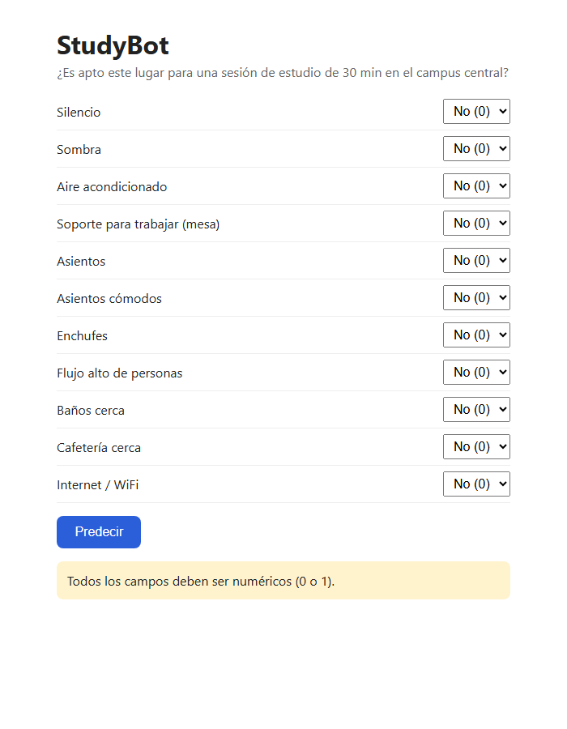

# StudyBot – Aplicación web

Aplicación Flask que carga el modelo entrenado (Random Forest, Dataset v1.0) y predice si un lugar del campus central de la Universidad de Colima es **APTO** o **NO APTO** para una sesión de estudio de 30 minutos.

## Archivos
- `app.py` – aplicación Flask (carga `studybot_model.joblib`, valida el formulario y predice).
- `templates/index.html` – formulario y resultado.
- `studybot_model.joblib` – modelo entrenado + orden de las 11 variables.
- `predictor.py` – función `predecir()` (Paso 2).
- `train_model.py` – script que entrenó y guardó el modelo (no lo usa la app).
- `Dataset v1.0.csv` – datos de entrenamiento.
- `evidencias/` – capturas de las pruebas en la aplicación.

## Ejecución
```bash
python -m venv venv
source venv/bin/activate        # Windows: venv\Scripts\activate
pip install -r requirements.txt
python app.py
```
Abrir http://127.0.0.1:5000, elegir Sí/No en cada variable y pulsar **Predecir**.

(Opcional) Para regenerar el modelo: `python train_model.py`.

## Modelo

Modelo: Random Forest (100 árboles, `random_state=42`), split 80/20; exactitud en prueba = 1.00.
Variables (11, binarias 0/1): silencio, sombra, aire_acondicionado, soporte_para_trabajar, asientos, asientos_comodos, enchufes, flujo_personas, banos_cerca, cafeteria_cerca, internet_wifi.

## Pruebas (orden de entrada = orden de las variables)

| # | Caso | Entrada | Resultado | P(APTO) | Interpretación |
|---|------|---------|-----------|---------|----------------|
| 1 | Laboratorio ideal | 1,1,1,1,1,1,1,0,1,0,1 | **APTO** | 1.00 | Silencio, clima, mesas, asientos cómodos, enchufes y WiFi: coincide con los laboratorios/bibliotecas del dataset, todos APTO. |
| 2 | Árbol al aire libre | 0,0,0,0,0,0,0,1,0,0,1 | **NO APTO** | 0.00 | Sin silencio, sombra, mesa ni asiento; solo WiFi. Igual que los "Árbol a un lado de telemática" del dataset. |
| 3 | Cafetería | 0,1,0,1,1,1,0,1,0,1,1 | **APTO** | 0.88 | Hay ruido y flujo de gente, pero mesa, asientos cómodos y WiFi compensan; consistente con las cafeterías del dataset. |
| 4 | **Caso discutible (frontera)** | 0,0,1,1,1,0,1,0,0,1,0 | **NO APTO** | 0.50 | Hay aire, mesa, asiento y enchufes, pero sin silencio, sin sombra ni WiFi. Los árboles votan 50/50 y el empate se resuelve a NO APTO; un estudiante podría considerarlo aceptable. |

Las mismas 4 entradas dieron el mismo resultado en la función `predecir()` y en la aplicación web (probada con el cliente de pruebas de Flask). También se validó que valores como `abc` o `5` se rechazan con un mensaje de error.
La app usa el modelo guardado: en `app.py` no hay reglas escritas a mano ni `fit()`.

### Capturas

**Prueba 1 – Laboratorio ideal (APTO)**



**Prueba 2 – Árbol al aire libre (NO APTO)**


**Prueba 3 – Cafetería (APTO)**


**Prueba 4 – Caso frontera (NO APTO, 50%)**


**Validación – valor no numérico rechazado**



## Preguntas

1. **¿Qué contiene `studybot_model.joblib`?** Un diccionario con el Random Forest ya entrenado (los 100 árboles con sus divisiones y parámetros aprendidos) y la lista ordenada de las 11 variables que espera. No contiene los datos de entrenamiento ni código de la app.
2. **¿Por qué no ejecutar `fit()` en la app?** Entrenar es lento y se repetiría en cada inicio o petición; además podría cambiar el modelo (aleatoriedad, datos distintos) y dar resultados inconsistentes con los evaluados. La app solo debe hacer inferencia con el modelo ya validado.
3. **¿Por qué el mismo preprocesamiento?** El modelo aprendió con datos en cierto formato (mismas columnas, mismo orden, misma escala/codificación). Si al predecir se transforman distinto, las entradas no significan lo mismo para el modelo y las predicciones serían erróneas. Aquí no hay escalado, pero sí importa usar las mismas columnas y el mismo orden (por eso se guardan en el joblib).
4. **Flask local vs. uso real.** Localmente, el servidor de desarrollo corre en tu equipo, para una sola persona y sin seguridad. En uso real se despliega en un servidor/nube con un servidor WSGI (gunicorn), HTTPS, `debug` desactivado, dependencias fijas, un dominio público, y manejo de concurrencia, errores, monitoreo y seguridad.

## Despliegue en Render (opcional)
1. Sube todo el proyecto a GitHub (incluye `studybot_model.joblib`, `Procfile` y `requirements.txt`).
2. En https://render.com crea una cuenta y elige **New → Web Service**, conectando tu repositorio.
3. Configura:
   - **Runtime:** Python 3
   - **Build Command:** `pip install -r requirements.txt`
   - **Start Command:** `gunicorn app:app`
   - **Instance type:** Free
4. Pulsa **Create Web Service**. Al terminar el build, Render te da una URL pública `https://<nombre>.onrender.com`.

Nota: en el plan gratuito la app se "duerme" tras inactividad y la primera visita tarda ~1 minuto.
