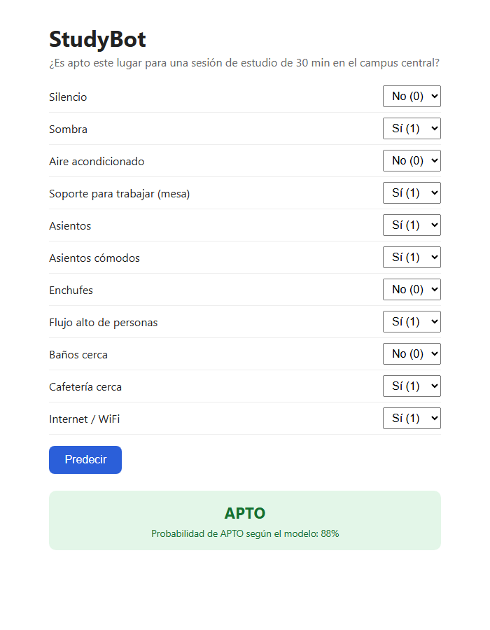
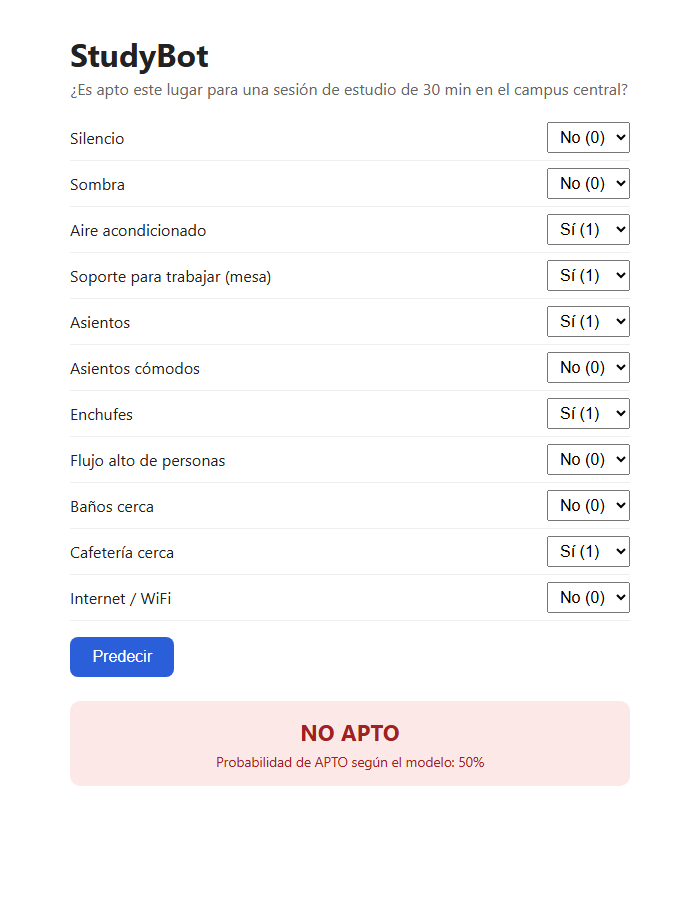

# StudyBot – Aplicación web

En esta práctica tomé el modelo que entrené en la segunda entrega (Random Forest con mi Dataset v1.0) y lo usé desde una aplicación web hecha con Flask. La app predice si un lugar del campus central de la Universidad de Colima es **APTO** o **NO APTO** para una sesión de estudio de 30 minutos.

## Archivos
- `app.py` – aplicación Flask (carga `studybot_model.joblib`, valida el formulario y predice).
- `templates/index.html` – formulario y resultado.
- `studybot_model.joblib` – modelo entrenado + orden de las 11 variables.
- `predictor.py` – función `predecir()` (Paso 2).
- `train_model.py` – script que entrenó y guardó el modelo (no lo usa la app).
- `Dataset v1.0.csv` – datos de entrenamiento.
- `evidencias/` – capturas de las pruebas en la aplicación.

## Ejecución
```bash
python -m venv venv
source venv/bin/activate        # Windows: venv\Scripts\activate
pip install -r requirements.txt
python app.py
```
Después se abre http://127.0.0.1:5000, se elige Sí/No en cada variable y se presiona **Predecir**.

(Opcional) Si se quiere volver a generar el modelo: `python train_model.py`.

## Modelo

Usé un Random Forest de 100 árboles (`random_state=42`) y separé los datos en 80% entrenamiento y 20% prueba. En el conjunto de prueba obtuve una exactitud de 1.00.

Trabajé con las mismas 11 variables de la segunda entrega, todas binarias (0 = no, 1 = sí): silencio, sombra, aire_acondicionado, soporte_para_trabajar, asientos, asientos_comodos, enchufes, flujo_personas, banos_cerca, cafeteria_cerca e internet_wifi.

## Pruebas

Las entradas están en el mismo orden que la lista de variables de arriba.

| # | Caso | Entrada | Resultado | P(APTO) | Interpretación |
|---|------|---------|-----------|---------|----------------|
| 1 | Laboratorio ideal | 1,1,1,1,1,1,1,0,1,0,1 | **APTO** | 1.00 | Tiene silencio, clima, mesa, asientos cómodos, enchufes y WiFi. Se parece a los laboratorios y bibliotecas de mi dataset, que salieron todos APTO. |
| 2 | Árbol al aire libre | 0,0,0,0,0,0,0,1,0,0,1 | **NO APTO** | 0.00 | No tiene silencio, sombra, mesa ni asiento; lo único que tiene es WiFi. Es igual a los árboles junto a telemática que registré en el dataset. |
| 3 | Cafetería | 0,1,0,1,1,1,0,1,0,1,1 | **APTO** | 0.88 | Hay ruido y pasa mucha gente, pero la mesa, los asientos cómodos y el WiFi compensan. Coincide con las cafeterías que registré. |
| 4 | **Caso discutible (frontera)** | 0,0,1,1,1,0,1,0,0,1,0 | **NO APTO** | 0.50 | Tiene aire, mesa, asiento y enchufes, pero no hay silencio, sombra ni WiFi. La mitad de los árboles votó APTO y la otra mitad NO APTO, y el empate quedó en NO APTO. Yo creo que para algunos estudiantes sí podría ser un lugar aceptable. |

Probé las mismas 4 entradas en la función `predecir()` y en la aplicación web, y en ambas obtuve el mismo resultado. También comprobé que la app rechaza valores como `abc` o `5` y muestra un mensaje de error.

La app usa el modelo guardado: en `app.py` no escribí reglas a mano ni llamo a `fit()`.

### Capturas

**Prueba 1 – Laboratorio ideal (APTO)**


**Prueba 2 – Árbol al aire libre (NO APTO)**


**Prueba 3 – Cafetería (APTO)**



**Prueba 4 – Caso frontera (NO APTO, 50%)**



**Validación – valor no numérico rechazado**


## Preguntas

**1. ¿Qué contiene el archivo `studybot_model.joblib`?**
Guardé un diccionario con dos cosas: el Random Forest ya entrenado (los 100 árboles con las divisiones que aprendió) y la lista de las 11 variables en el orden en que el modelo las espera. No contiene los datos de entrenamiento ni el código de la aplicación.

**2. ¿Por qué no se debe volver a ejecutar `fit()` dentro de la aplicación?**
Porque entrenar tarda y se repetiría cada vez que se inicia la app o llega una petición. Además, el modelo podría cambiar (por la aleatoriedad o por usar otros datos) y ya no sería el mismo que evalué. La app solo tiene que predecir con el modelo que ya validé.

**3. ¿Por qué la aplicación debe usar exactamente el mismo preprocesamiento utilizado durante el entrenamiento?**
Porque el modelo aprendió con los datos en un formato específico: ciertas columnas, en cierto orden y con cierta codificación. Si al predecir los datos llegan de otra forma, el modelo los interpreta mal y las predicciones salen equivocadas. En mi caso no usé escalado, pero sí es importante respetar las mismas columnas y el mismo orden, y por eso los guardé junto con el modelo en el joblib.

**4. ¿Qué diferencia existe entre ejecutar Flask localmente y desplegar una aplicación para uso real?**
Cuando ejecuto Flask localmente uso su servidor de desarrollo, que corre en mi computadora, solo lo uso yo y no tiene medidas de seguridad. Para uso real la app se tiene que desplegar en un servidor o en la nube, con un servidor como gunicorn, HTTPS, el modo `debug` apagado, versiones fijas de las librerías y una dirección pública. También hay que pensar en que muchas personas la usen al mismo tiempo, en manejar errores, en monitorearla y en la seguridad.

## Despliegue en Render (opcional)
1. Subir todo el proyecto a GitHub (incluyendo `studybot_model.joblib`, `Procfile` y `requirements.txt`).
2. En https://render.com crear una cuenta, elegir **New → Web Service** y conectar el repositorio.
3. Configurar:
   - **Runtime:** Python 3
   - **Build Command:** `pip install -r requirements.txt`
   - **Start Command:** `gunicorn app:app`
   - **Instance type:** Free
4. Presionar **Create Web Service**. Cuando termina el build, Render da una URL pública `https://<nombre>.onrender.com`.

Nota: en el plan gratuito la app se "duerme" si nadie la usa por un rato, y la primera visita puede tardar alrededor de un minuto.
